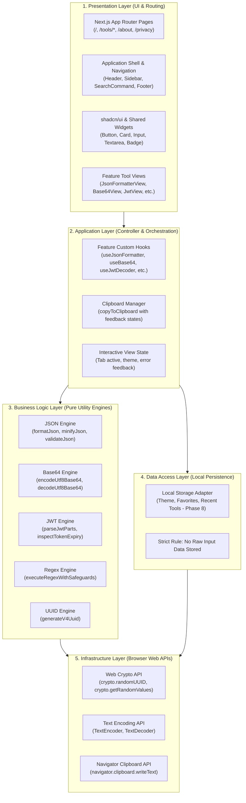
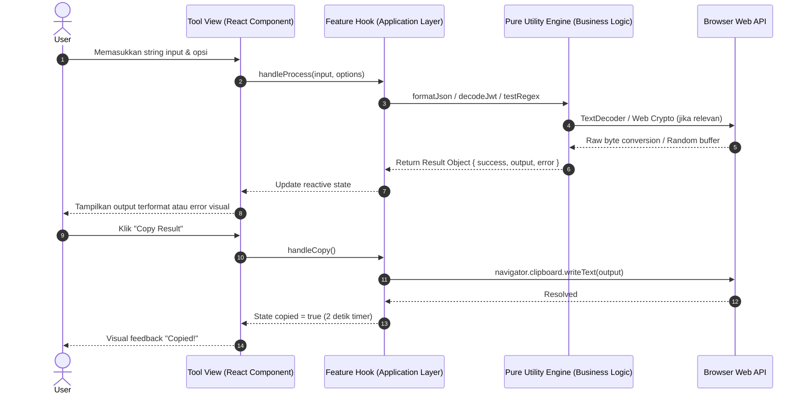
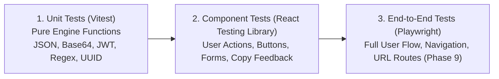
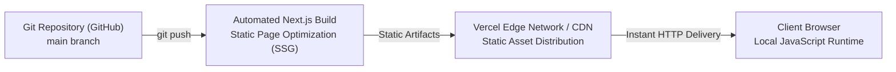

# TECHNICAL PLAN — DEVTOOLKIT

**Dokumen Referensi Utama**: [PRD and Playbook.md](./PRD%20and%20Playbook.md)  
**Versi**: 1.0.0  
**Status**: Approved (Phase 2 Deliverable)  
**Tanggal**: 2026-11-04  
**Penulis**: Senior Software Architect / Solo Fullstack Developer  

---

## 1. Executive Summary & Architectural Decisions

DevToolkit dirancang dan dibangun sebagai platform *browser-based developer utilities* modern dengan prinsip **Client-Side First Modular Monolith**. Fokus utama arsitektur ini adalah kecepatan respons instan tanpa dependensi server yang berlebihan, jaminan privasi data 100% (*zero data leak by design*), kemudahan pemeliharaan (*maintainability*), serta eliminasi biaya infrastruktur dan kompleksitas operasional backend untuk lingkup MVP.

### Ringkasan Keputusan Teknis Utama:

| Komponen | Keputusan Teknis | Rasionalisasi & Batasan |
| :--- | :--- | :--- |
| **Pola Arsitektur** | Modular Monolith (Client-Side First) | Menjaga seluruh codebase tetap kohesif, modular, dan terstruktur tanpa kompleksitas microservices atau overhead komunikasi antar-jaringan. |
| **Framework Utama** | Next.js 16 (App Router) | Menggunakan App Router untuk file-based routing yang deklaratif, metadata API untuk optimalisasi SEO halaman setiap tools, dan performa *static generation* (SSG). |
| **Bahasa Pemrograman** | TypeScript 5 (Strict Mode) | Type safety penuh, eliminasi runtime type errors (`no-explicit-any`), serta pendefinisian kontrak input/output yang eksplisit. |
| **Styling & Design System** | Tailwind CSS v4 + shadcn/ui | Utility-first CSS dengan *zero runtime overhead*, dipadukan dengan komponen shadcn/ui yang accessible (WAI-ARIA compliant) dan mudah dikustomisasi. |
| **Eksekusi Business Logic** | Client-side Pure Functions | Pemrosesan utilitas (JSON, Base64, JWT, Regex, UUID) dieksekusi 100% di browser pengguna tanpa mengirim payload ke server. |
| **Backend & Database** | Tidak Ada / Zero Backend (MVP) | Mengurangi titik kegagalan (Single Point of Failure), menurunkan latensi eksekusi hingga ~0ms, dan menghilangkan risiko kebocoran data sensitif. |
| **Autentikasi** | Tanpa Autentikasi | Pengguna dapat langsung mengakses seluruh fitur secara bebas tanpa registrasi, login, session guard, atau middleware proteksi. |
| **State Management** | React State (`useState`, `useReducer`, Custom Hooks) | State bersifat lokal pada level komponen/halaman tool. Tidak memerlukan Zustand pada MVP kecuali saat persistensi lintas halaman dibutuhkan di Phase 8. |
| **Validasi & Skema** | Zod | Single source of truth untuk validasi runtime pada parameter tool dan opsi konfigurasi. |
| **Testing Suite** | Vitest + React Testing Library | Test runner modern yang sangat cepat dan kompatibel dengan arsitektur pure functions dan komponen React. |

---

## 2. Technical Architecture & Layered System

DevToolkit mengadopsi pemisahan lapisan tanggung jawab (*Separation of Concerns*) berlapis yang ketat untuk menjamin kebersihan kode dan independensi pengujian unit:



### Tanggung Jawab Setiap Lapisan:
1. **Presentation Layer**: Menangani rendering tampilan, tata letak visual (*layout*), penerimaan interaksi pengguna, dan pemetaan routing URL. Komponen di lapisan ini tidak boleh melakukan manipulasi string/kalkulasi matematika secara langsung.
2. **Application Layer**: Mengontrol alur state halaman tool, menghubungkan UI event dengan engine utilitas, serta mengelola feedback status (loading, error, success copy).
3. **Business Logic Layer**: Kumpulan fungsi murni (*pure functions*) yang menerima input tertentu dan mengembalikan output terprediksi. Bebas dari ketergantungan framework React atau DOM.
4. **Data Access Layer**: Mengisolasi penyimpanan preferensi lokal ke `localStorage`. Menjamin data sensitif pengguna (seperti token JWT atau raw JSON) tidak pernah tersimpan.
5. **Infrastructure Layer**: Berinteraksi langsung dengan antarmuka native browser (Web Crypto, TextEncoder/Decoder, Clipboard).

---

## 3. Application Routing & Page Structure

Routing DevToolkit memanfaatkan Next.js App Router dengan arsitektur direktori flat dan eksplisit:

```
src/app/
├── layout.tsx                     # Root application layout (HTML skeleton, Fonts, Providers)
├── page.tsx                       # Homepage Dashboard (Tool Grid, Search, Categories)
├── globals.css                    # Tailwind CSS v4 variables & base reset
├── favicon.ico                    # Browser favicon
│
├── tools/
│   ├── json-formatter/
│   │   └── page.tsx               # JSON Formatter & Validator tool page
│   ├── base64/
│   │   └── page.tsx               # Base64 Text Encoder & Decoder tool page
│   ├── jwt-decoder/
│   │   └── page.tsx               # JWT Header, Payload & Expiry Inspector page
│   ├── regex-tester/
│   │   └── page.tsx               # Interactive Regular Expression Tester page
│   └── uuid-generator/
│       └── page.tsx               # RFC4122 v4 UUID Batch Generator page
│
├── about/
│   └── page.tsx                   # Platform mission, architecture & technology overview
└── privacy/
    └── page.tsx                   # Strict Client-Side Privacy Guarantee statement
```

Setiap halaman di bawah `/tools/*` memiliki deklarasi static metadata untuk optimasi search engine (SEO) yang relevan dengan kata kunci developer.

---

## 4. Final Directory Structure & Module Boundaries

Struktur folder final didesain dengan pendekatan modular berbasis fitur (*feature-driven*) tanpa over-engineering:

```
devtoolkit/
├── public/
│   ├── file.svg
│   ├── globe.svg
│   ├── next.svg
│   ├── vercel.svg
│   └── window.svg
│
├── src/
│   ├── app/                       # Routing & Static Metadata Layer
│   │   ├── layout.tsx
│   │   ├── page.tsx
│   │   ├── globals.css
│   │   ├── favicon.ico
│   │   ├── tools/
│   │   │   ├── json-formatter/page.tsx
│   │   │   ├── base64/page.tsx
│   │   │   ├── jwt-decoder/page.tsx
│   │   │   ├── regex-tester/page.tsx
│   │   │   └── uuid-generator/page.tsx
│   │   ├── about/page.tsx
│   │   └── privacy/page.tsx
│   │
│   ├── components/                # Reusable UI & Layout Components
│   │   ├── layout/                # Shell, Header, Sidebar, Nav, Footer
│   │   │   ├── app-shell.tsx
│   │   │   ├── header.tsx
│   │   │   ├── sidebar.tsx
│   │   │   └── footer.tsx
│   │   ├── tools/                 # Tool-agnostic visual wrappers
│   │   │   ├── tool-layout.tsx    # Header, Action Bar, Two-Panel Layout
│   │   │   ├── tool-card.tsx      # Dashboard Card Item
│   │   │   ├── copy-button.tsx    # Reusable Copy to Clipboard Button
│   │   │   └── search-dialog.tsx  # Fast tool search modal (Cmd+K)
│   │   ├── editor/                # Editor components (Phase 5)
│   │   └── ui/                    # shadcn/ui primitive components
│   │       ├── button.tsx
│   │       ├── card.tsx
│   │       ├── input.tsx
│   │       ├── textarea.tsx
│   │       ├── badge.tsx
│   │       ├── tabs.tsx
│   │       └── ...
│   │
│   ├── features/                  # Domain-specific Feature Modules
│   │   ├── json-formatter/
│   │   │   ├── components/        # JsonFormatterView, IndentSelector
│   │   │   ├── utils/             # json-engine.ts
│   │   │   ├── hooks/             # use-json-formatter.ts
│   │   │   └── types.ts
│   │   ├── base64/
│   │   │   ├── components/        # Base64View, ModeToggle
│   │   │   ├── utils/             # base64-engine.ts
│   │   │   ├── hooks/             # use-base64.ts
│   │   │   └── types.ts
│   │   ├── jwt-decoder/
│   │   │   ├── components/        # JwtDecoderView, ExpiryBadge, TokenPartCard
│   │   │   ├── utils/             # jwt-engine.ts
│   │   │   ├── hooks/             # use-jwt-decoder.ts
│   │   │   └── types.ts
│   │   ├── regex-tester/
│   │   │   ├── components/        # RegexTesterView, FlagSelector, MatchList
│   │   │   ├── utils/             # regex-engine.ts
│   │   │   ├── hooks/             # use-regex-tester.ts
│   │   │   └── types.ts
│   │   └── uuid-generator/
│   │       ├── components/        # UuidGeneratorView, BatchSelector, UuidItem
│   │       ├── utils/             # uuid-engine.ts
│   │       ├── hooks/             # use-uuid-generator.ts
│   │       └── types.ts
│   │
│   ├── data/                      # Static metadata & catalogs
│   │   └── tools.ts               # Daftar tools, kategori, icon, slug, deskripsi
│   │
│   ├── hooks/                     # Shared cross-cutting hooks
│   │   ├── use-clipboard.ts       # Hook copy dengan auto-reset feedback
│   │   └── use-keyboard-shortcut.ts # Shortcut bindings (Ctrl/Cmd+K)
│   │
│   ├── lib/                       # Common cross-cutting utilities
│   │   ├── utils.ts               # Tailwind cn helper
│   │   └── clipboard.ts           # Safe clipboard navigator fallback
│   │
│   └── types/                     # Global common types
│       ├── tool.ts                # Tool metadata interface
│       └── index.ts
│
├── tests/                         # Integration & Unit Test Suite
│   ├── features/                  # Unit tests per feature engine
│   └── example.test.ts
│
├── components.json                # shadcn/ui configuration
├── next.config.ts                 # Next.js bundler & turbopack configuration
├── vitest.config.mts              # Vitest test configuration
├── vitest.setup.ts                # Test setup & jest-dom matchers
├── tsconfig.json                  # Strict TypeScript compiler options
└── package.json
```

---

## 5. Business Logic Contracts & Utility Function Interfaces

Seluruh engine utilitas di bawah `src/features/*/utils/` diwajibkan berupa *Pure Functions* dengan kontrak data yang kuat:

### 5.1 JSON Formatter Engine (`src/features/json-formatter/utils/json-engine.ts`)

```typescript
export type IndentationType = 2 | 4 | 'tab';

export interface JsonFormatOptions {
  indentation: IndentationType;
}

export interface JsonFormatResult {
  success: boolean;
  output: string;
  error?: string;
  stats?: {
    sizeBytes: number;
    lines: number;
  };
}

export interface JsonValidationResult {
  isValid: boolean;
  error?: string;
  line?: number;
  column?: number;
}

export function formatJson(input: string, options: JsonFormatOptions): JsonFormatResult;
export function minifyJson(input: string): JsonFormatResult;
export function validateJson(input: string): JsonValidationResult;
```

### 5.2 Base64 Encoder / Decoder Engine (`src/features/base64/utils/base64-engine.ts`)

> **Catatan Arsitektur**: `btoa()` dan `atob()` bawaan browser gagal pada karakter multi-byte UTF-8 (seperti emoji atau aksara non-Latin). Implementasi wajib menggunakan `TextEncoder` dan `TextDecoder` yang dipasangkan dengan buffer biner.

```typescript
export interface Base64Result {
  success: boolean;
  output: string;
  error?: string;
}

export function encodeBase64(input: string): Base64Result;
export function decodeBase64(input: string): Base64Result;
```

### 5.3 JWT Decoder Engine (`src/features/jwt-decoder/utils/jwt-engine.ts`)

> **Catatan Keamanan**: Utilitas ini secara tegas **HANYA** melakukan *decoding* representasi Base64Url dari token JWT. Utilitas ini **TIDAK** memverifikasi tanda tangan kriptografi (*cryptographic signature*). UI wajib menampilkan *disclaimer* keamanan ini secara eksplisit.

```typescript
export interface JwtHeader {
  alg?: string;
  typ?: string;
  kid?: string;
  [key: string]: unknown;
}

export interface JwtPayload {
  iss?: string;
  sub?: string;
  aud?: string | string[];
  exp?: number;
  nbf?: number;
  iat?: number;
  jti?: string;
  [key: string]: unknown;
}

export type TokenExpiryStatus = 'active' | 'expired' | 'no-expiry' | 'invalid';

export interface DecodedJwtResult {
  success: boolean;
  header: JwtHeader | null;
  payload: JwtPayload | null;
  signature: string | null;
  headerRaw: string;
  payloadRaw: string;
  expiryDate: Date | null;
  expiryStatus: TokenExpiryStatus;
  timeRemainingFormatted?: string;
  error?: string;
}

export function decodeJwt(token: string): DecodedJwtResult;
```

### 5.4 Regex Tester Engine (`src/features/regex-tester/utils/regex-engine.ts`)

> **Catatan Perlindungan ReDoS & Infinite Loop**: Ketika flag global (`g`) digunakan bersamaan dengan pattern berukuran nol (misalnya `a*` pada string `b`), `RegExp.exec()` dapat menyebabkan *infinite loop* jika index `lastIndex` tidak dimajukan secara manual. Engine ini menyediakan pengaman *max matches* dan *execution safeguard*.

```typescript
export interface RegexMatchItem {
  match: string;
  index: number;
  length: number;
  groups?: Record<string, string>;
}

export interface RegexTestResult {
  isValidPattern: boolean;
  patternError?: string;
  matches: RegexMatchItem[];
  matchCount: number;
  executionTimeMs: number;
}

export function testRegex(
  pattern: string,
  flags: string,
  testString: string,
  maxMatches?: number
): RegexTestResult;
```

### 5.5 UUID Generator Engine (`src/features/uuid-generator/utils/uuid-engine.ts`)

> **Standar Implementasi**: Menggunakan `crypto.randomUUID()` RFC4122 v4 standar browser modern, dengan *fallback* aman menggunakan `crypto.getRandomValues()` untuk menjamin kompatibilitas tanpa dependensi eksternal pihak ketiga.

```typescript
export interface UuidGenerateOptions {
  count: number;
  uppercase?: boolean;
  hyphens?: boolean;
}

export function generateUuidV4(): string;
export function generateBatchUuids(options: UuidGenerateOptions): string[];
```

### 5.6 Clipboard Helper (`src/lib/clipboard.ts`)

```typescript
export interface CopyResult {
  success: boolean;
  error?: string;
}

export function copyToClipboard(text: string): Promise<CopyResult>;
```

---

## 6. State Management Strategy & Data Flow

### 6.1 Prinsip Local State by Default
- Setiap tool mengisolasi statusnya sendiri menggunakan React `useState` / `useReducer` di dalam *custom hook* fitur masing-masing (misal: `useJsonFormatter`).
- Parameter seperti input teks, output transformasi, konfigurasi format, dan pesan error disimpan dalam memory komponen aktif dan langsung dibebaskan (*garbage collected*) saat pengguna berpindah halaman.
- Tidak ada global state store untuk isi input pengguna. Hal ini menjamin privasi maksimal dan menghindari kebocoran memori pada data berukuran besar.



### 6.2 Batasan Penggunaan Global State (Zustand)
- Pada lingkup P0 (Phase 1–7), Zustand **TIDAK** digunakan.
- Pada Phase 8 (P1 Features), Zustand hanya dipertimbangkan untuk:
  - Menyimpan preferensi tema (Dark/Light Mode).
  - Menyimpan daftar tool favorit (`favoriteToolIds: string[]`).
  - Menyimpan daftar riwayat penggunaan tools (`recentlyUsedToolIds: string[]`).
  - Input atau token pengguna **DILARANG** dimasukkan ke dalam global store.

---

## 7. Testing Strategy & Quality Assurance

Strategi pengujian difokuskan pada keandalan engine utilitas logika bisnis secara independen:



### 7.1 Unit Testing Matrix (Vitest)
Setiap engine utilitas wajib memiliki test file di bawah `tests/features/`:
1. **JSON Engine**:
   - Format valid JSON (2 spaces, 4 spaces, tab).
   - Minify JSON.
   - Deteksi syntax error (trailing comma, unquoted keys, mismatched brackets).
   - Penanganan payload kosong, tipe primitif (boolean, number, string, null).
2. **Base64 Engine**:
   - Encoding ASCII standar.
   - Encoding teks Unicode multi-byte (Bahasa Indonesia, aksara Asia, emoji 🚀).
   - Decoding Base64 valid kembali ke string asli tanpa corrupt.
   - Penanganan string Base64 tidak valid / corrupted.
3. **JWT Engine**:
   - Parsing token 3-bagian standar (Header.Payload.Signature).
   - Parsing token expired vs token aktif.
   - Penanganan token tanpa expiry claim (`exp`).
   - Penanganan token malformed (hanya 1 bagian, karakter non-Base64Url, json rusak).
4. **Regex Engine**:
   - Pencocokan standar dengan flags `g`, `i`, `m`.
   - Pencegahan loop tanpa henti pada zero-length matches (misal `.*`).
   - Penanganan syntax error pattern (unclosed parenthesis).
5. **UUID Engine**:
   - Validitas format UUID v4 (`/^[0-9a-f]{8}-[0-9a-f]{4}-4[0-9a-f]{3}-[89ab][0-9a-f]{3}-[0-9a-f]{12}$/i`).
   - Keunikan pada batch generation (100 UUID tanpa duplikasi).

---

## 8. Security & Privacy Architecture

Keamanan dan privasi adalah proposisi nilai utama DevToolkit:

1. **Jaminan Pemrosesan Klien Penuh (Zero Data Transmission)**:
   - Tidak ada network request atau telemetry yang mengirimkan input pengguna ke remote server.
   - Tidak ada integrasi skrip analytics pihak ketiga yang membaca isi field input.
2. **Mitigasi ReDoS (Regular Expression Denial of Service)**:
   - Regex testing dieksekusi secara defensif.
   - Pembatasan jumlah kecocokan maksimum (*match cap*, default: 1.000 matches) untuk mencegah freeze pada string pengujian raksasa.
   - Penanganan eksplisit `lastIndex` pada zero-length match global regex.
3. **Pemberitahuan Keamanan JWT**:
   - Tampilan visual yang menegaskan bahwa verifikasi signature kriptografis memerlukan secret/public key yang sengaja tidak dilakukan di browser untuk mencegah eksposur kunci rahasia.
4. **Pencegahan XSS (Cross-Site Scripting)**:
   - Output hasil formatting dirender melalui text binding standar React atau komponen CodeMirror terisolasi.
   - Tidak pernah menggunakan `dangerouslySetInnerHTML` atau fungsi `eval()` untuk parsing kode atau JSON.

---

## 9. Dependency Strategy & Validation

Sesuai dengan *Global AI Coding Rules* (Part C Section 5), setiap dependensi diverifikasi secara ketat:

| Dependency | Tipe | Alasan & Justifikasi Teknis | Status |
| :--- | :--- | :--- | :--- |
| `next` | Production | Framework inti untuk App Router, SSG, dan SEO | Terpasang |
| `react` & `react-dom` | Production | UI library inti versi 19 | Terpasang |
| `lucide-react` | Production | Kumpulan icon yang konsisten, ringan, dan tree-shakeable | Terpasang |
| `zod` | Production | Validasi schema deklaratif dan type inference | Terpasang |
| `class-variance-authority` | Production | Utility untuk variant komponen shadcn/ui | Terpasang |
| `@base-ui/react` | Production | Primitif headless UI untuk shadcn/ui | Terpasang |
| `vitest` | Dev | Test runner cepat berbasis native ESM & Vite | Terpasang |
| `@testing-library/react` | Dev | DOM testing utilities untuk komponen React | Terpasang |
| `jsdom` | Dev | Simulasi browser environment untuk testing | Terpasang |
| `CodeMirror 6` | Production | Editor kode dengan syntax highlighting (JSON, Regex) | **Ditunda ke Phase 5** |
| `Zustand` | Production | Global state management untuk favorites/recents | **Ditunda ke Phase 8** |
| `Axios` | - | **Ditolak**: Fetch native browser sudah mencukupi | Dieliminasi |
| `uuid` (npm) | - | **Ditolak**: Web Crypto `crypto.randomUUID()` native | Dieliminasi |
| `jsonwebtoken` | - | **Ditolak**: Mengandung dependensi Node.js crypto berat; Base64Url decode native sudah memadai untuk inspeksi | Dieliminasi |

---

## 10. Technical & Performance Risk Assessment

| Risiko Teknis | Dampak Potensial | Probabilitas | Strategi Mitigasi Terencana |
| :--- | :--- | :--- | :--- |
| **ReDoS & Infinite Loop pada Regex** | Browser tab pengguna menjadi tidak responsif (*freezing*). | Sedang | Batasi jumlah pencocokan (*match limit* 1.000), paksa increment `lastIndex` saat match berpanjang 0. |
| **Input JSON Sangat Besar (>10MB)** | UI lag saat memformat string JSON raksasa. | Rendah | Validasi batasan ukuran input sebelum parsing; tampilkan peringatan ukuran file. |
| **Kegagalan Izin Clipboard** | Tombol copy tidak berfungsi pada browser tanpa izin clipboard API. | Rendah | Sediakan fallback menggunakan `document.execCommand('copy')` atau instruksi seleksi manual jika Promise clipboard ditolak. |
| **Karakter Unicode Rusak pada Base64** | Teks berkarakter khusus (emoji, aksara non-Latin) rusak saat diencode. | Tinggi | Implementasikan konversi biner berbasis `TextEncoder('utf-8')` dan `TextDecoder('utf-8')` secara wajib. |
| **Persepsi Keliru pada JWT Decoder** | Pengguna mengira token valid secara kriptografi hanya karena berhasil didecode. | Sedang | Tampilkan banner peringatan status: *"Token Decoded Only — Signature not verified with private key"*. |

---

## 11. Deployment Architecture & Operations



- **Platform Target**: Vercel atau static hosting provider (Cloudflare Pages / VPS Nginx).
- **Karakteristik**: Seluruh halaman dapat di-*prerender* secara statis (SSG) karena tidak memerlukan server-side runtime database atau dynamic session rendering pada level server.
- **Biaya Operasional**: Bebas biaya server (*Zero server compute cost*), skalabilitas horizontal tak terbatas melalui CDN global.

---

Dokumen ini menjadi acuan arsitektur final untuk Phase 3 (UI/UX Planning) hingga Phase 10 (Production Release).

