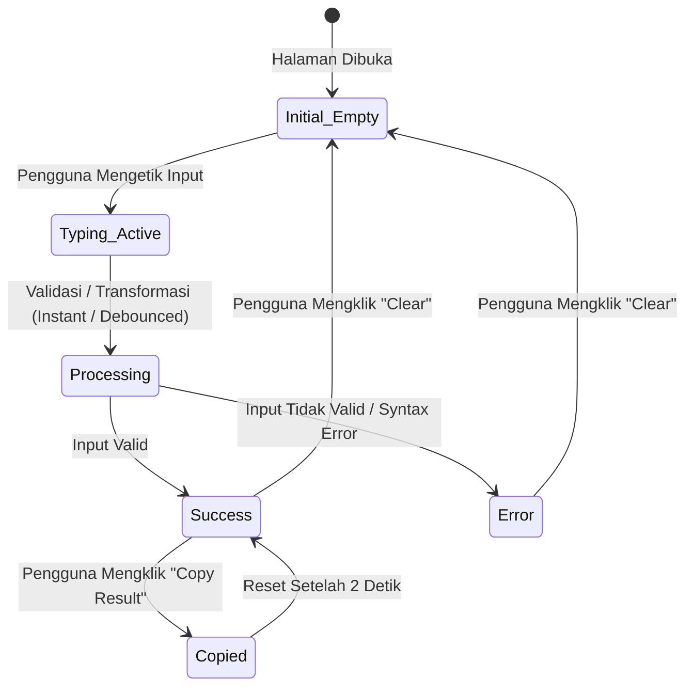

# UI/UX DESIGN SYSTEM & INTERACTION GUIDE — DEVTOOLKIT

**Dokumen Referensi Utama**: [PRD and Playbook.md](./PRD%20and%20Playbook.md) & [TECHNICAL_PLAN.md](./TECHNICAL_PLAN.md)  
**Versi**: 1.0.0  
**Status**: Approved (Phase 3 Deliverable)  
**Tanggal**: 2026-11-04  
**Penulis**: Senior Product Designer & Frontend Architect  

---

## 1. Design Philosophy & Visual Direction

DevToolkit mengusung filosofi desain **"Modern Developer Dashboard"**: minimalis, presisi, tanpa gangguan iklan (*distraction-free*), dan berorientasi pada produktivitas teknis developer (*utility-first*).

### 1.1 Prinsip Desain Utama:
1. **Zero Clutter & Zero Distraction**: Fokus 100% pada utilitas kerja. Tidak ada pop-up iklan, banner cookie invasif, atau elemen dekoratif yang menghambat pekerjaan developer.
2. **Instant Feedback & Dense Usability**: Setiap pengetikan atau penekanan tombol memicu respons visual langsung (*real-time reactive updates*). Informasi disajikan secara padat namun rapi (*dense yet breathable*).
3. **Monospaced Precision**: Kode, JSON, token JWT, regular expression, string Base64, dan UUID disajikan dengan tipografi monospace berkualitas tinggi (`Geist Mono`) dengan ukuran font, line-height, dan tab width yang konsisten.
4. **Keyboard-Driven Workflow**: Menyediakan pintasan keyboard global (misal `Cmd+K` / `Ctrl+K` untuk pencarian tools instan) dan navigasi tab yang intuitif untuk developer yang mengutamakan kecepatan tanpa mouse.
5. **Privacy by Design Visual Trust**: Antarmuka secara transparan menampilkan status bahwa data diproses 100% di browser pengguna melalui badge keamanan (*"Client-Side Only • No Server Upload"*).

---

## 2. Design Tokens & Styling Architecture

Design tokens diselaraskan secara natif dengan **Tailwind CSS v4** dan variabel CSS **shadcn/ui** yang telah dikonfigurasi pada Phase 1.

### 2.1 Color Palette & Semantic Tokens

Sistem warna menggunakan semantic tokens yang mendukung mode terang (*Light Mode*) dan gelap (*Dark Mode*):

| Token Name | Light Theme Value | Dark Theme Value | Peran & Penggunaan |
| :--- | :--- | :--- | :--- |
| `--background` | `hsl(0, 0%, 100%)` (#FFFFFF) | `hsl(0, 0%, 3.9%)` (#09090B) | Latar belakang kanvas utama aplikasi |
| `--foreground` | `hsl(0, 0%, 9%)` (#18181B) | `hsl(0, 0%, 98%)` (#FAFAFA) | Teks primer, heading, label aktif |
| `--card` | `hsl(0, 0%, 100%)` (#FFFFFF) | `hsl(0, 0%, 7%)` (#121215) | Permukaan kartu tool, panel editor |
| `--card-foreground`| `hsl(0, 0%, 9%)` (#18181B) | `hsl(0, 0%, 98%)` (#FAFAFA) | Teks isi pada permukaan kartu |
| `--primary` | `hsl(221.2, 83.2%, 53.3%)` (#2563EB)| `hsl(217.2, 91.2%, 59.8%)` (#3B82F6)| Aksen utama (tombol CTA, tab aktif, ring fokus) |
| `--primary-foreground`| `hsl(0, 0%, 98%)` (#FAFAFA) | `hsl(222.2, 47.4%, 11.2%)` (#0F172A)| Teks di atas warna primary |
| `--secondary` | `hsl(240, 4.8%, 95.9%)` (#F4F4F5) | `hsl(240, 3.7%, 15.9%)` (#27272A)| Tombol sekunder, filter kategori |
| `--muted` | `hsl(240, 4.8%, 95.9%)` (#F4F4F5) | `hsl(240, 3.7%, 15.9%)` (#27272A)| Latar belakang container kode, panel output kosong |
| `--muted-foreground` | `hsl(240, 3.8%, 46.1%)` (#71717A)| `hsl(240, 5%, 64.9%)` (#A1A1AA)| Subtitle, petunjuk input, metadata ukuran/baris |
| `--border` | `hsl(240, 5.9%, 90%)` (#E4E4E7)| `hsl(240, 3.7%, 15.9%)` (#27272A)| Garis pemisah panel, batas input/textarea |
| `--input` | `hsl(240, 5.9%, 90%)` (#E4E4E7)| `hsl(240, 3.7%, 15.9%)` (#27272A)| Border form control & toolbar |
| `--ring` | `hsl(221.2, 83.2%, 53.3%)` (#2563EB)| `hsl(217.2, 91.2%, 59.8%)` (#3B82F6)| Cincin fokus outline aksesibilitas |
| `--destructive` | `hsl(0, 84.2%, 60.2%)` (#EF4444) | `hsl(0, 62.8%, 30.6%)` (#7F1D1D)| Indikator error syntax, badge expired, reset |
| `--success` | `hsl(142.1, 76.2%, 36.3%)` (#16A34A)| `hsl(142.1, 70.6%, 45.3%)` (#22C55E)| Indikator "Copied!", status token aktif, match regex |

#### Palet Warna Kategori Tools:
Untuk mempercepat scanning visual pada dashboard, setiap kategori memiliki aksen badge khusus:
- **Formatters** (JSON): Biru (`bg-blue-500/10 text-blue-600 dark:text-blue-400 border-blue-500/20`)
- **Encoders** (Base64): Ungu (`bg-purple-500/10 text-purple-600 dark:text-purple-400 border-purple-500/20`)
- **Security & Tokens** (JWT): Amber/Oranye (`bg-amber-500/10 text-amber-600 dark:text-amber-400 border-amber-500/20`)
- **Testers** (Regex): Emerald/Hijau (`bg-emerald-500/10 text-emerald-600 dark:text-emerald-400 border-emerald-500/20`)
- **Generators** (UUID): Indigo/Sian (`bg-indigo-500/10 text-indigo-600 dark:text-indigo-400 border-indigo-500/20`)

---

### 2.2 Typography System

Menggunakan dua font utama yang dioptimalkan via `next/font`:
1. **Geist Sans**: Digunakan untuk seluruh elemen UI, heading, navigasi, deskripsi, dan button text.
2. **Geist Mono**: Digunakan untuk input editor, output data, JSON view, regular expression, token JWT, dan kode.

#### Skala Tipografi:

| Tingkat | Font Family | Size | Weight | Line Height | Contoh Penggunaan |
| :--- | :--- | :--- | :--- | :--- | :--- |
| **Display / Hero** | Geist Sans | `2.25rem` (36px) | Bold (700) | `2.5rem` | Headline Hero Dashboard |
| **Heading 1** | Geist Sans | `1.75rem` (28px) | SemiBold (600)| `2.25rem` | Judul Halaman Tool |
| **Heading 2** | Geist Sans | `1.25rem` (20px) | SemiBold (600)| `1.75rem` | Judul Seksi Dashboard / Kategori |
| **Heading 3** | Geist Sans | `1.0rem` (16px) | Medium (500) | `1.5rem` | Judul Panel Workspace (Input/Output) |
| **Body (Normal)** | Geist Sans | `0.875rem` (14px)| Regular (400) | `1.375rem` | Deskripsi tool, teks paragraf umum |
| **Body (Small)** | Geist Sans | `0.75rem` (12px) | Regular (400) | `1.0rem` | Badge status, breadcrumb, footer link |
| **Code Editor / Mono**| Geist Mono | `0.875rem` (14px)| Regular (400) | `1.5rem` | Isi Textarea Input & Output Workspace |
| **Code Micro** | Geist Mono | `0.75rem` (12px) | Medium (500) | `1.0rem` | Posisi regex match, info byte size |

---

### 2.3 Spacing, Border Radius & Elevation System

- **Base Grid**: 4px increment (`p-1` = 4px, `p-2` = 8px, `p-4` = 16px, `p-6` = 24px, `p-8` = 32px).
- **Container Max Width**: `max-w-7xl` (1280px) untuk dashboard dan workspace layout.
- **Border Radius**:
  - `rounded-lg` (8px): Kartu tool, container panel workspace, dialog popup.
  - `rounded-md` (6px): Tombol, input text, select dropdown, toolbar badge.
  - `rounded-full` (9999px): Badge pill kategori, status indicator dot.
- **Elevation & Shadows**:
  - Panel & Card: `shadow-sm` dengan border halus `border border-border/80` (gaya modern flat dengan depth minimal).
  - Modal & Command Palette: `shadow-xl` dengan backdrop blur `backdrop-blur-md bg-background/80`.

---

## 3. Application Layout & Navigation Specifications

### 3.1 Global Application Shell

```
┌────────────────────────────────────────────────────────────────────────┐
│ [Logo] DevToolkit   [Search Tools Cmd+K]       About   Privacy  [Theme]│ (Navbar: h-14)
├────────────────────────────────────────────────────────────────────────┤
│                                                                        │
│                       MAIN CONTENT AREA (Router)                       │
│                                                                        │
├────────────────────────────────────────────────────────────────────────┤
│ © 2026 DevToolkit • Client-side Developer Utilities • Privacy Guaranteed│ (Footer: h-16)
└────────────────────────────────────────────────────────────────────────┘
```

1. **AppNavbar (Tinggi: 56px / `h-14`)**:
   - Fixed di atas halaman dengan `sticky top-0 z-50 backdrop-blur-md bg-background/80 border-b border-border`.
   - Kiri: Logo DevToolkit (ikon terminal / code) + Brand Title.
   - Tengah/Kanan: Tombol shortcut Search Quick Access (`⌘K` / `Ctrl+K`).
   - Kanan: Tautan navigasi `About`, `Privacy`, dan icon GitHub / Theme Toggle.
2. **AppFooter (Tinggi: 64px / `h-16`)**:
   - Garis pemisah halus di atas `border-t border-border`.
   - Ringkasan hak cipta, jaminan client-side execution, dan tautan halaman statis.

---

## 4. Dashboard & Homepage UX Specifications

Layout dashboard berfokus pada kecepatan menemukan dan membuka tool yang dicari developer:

```
┌────────────────────────────────────────────────────────────────────────┐
│                              HERO SECTION                              │
│                    Essential Utilities for Developers                  │
│             Fast, clean, and 100% processed locally in your browser.   │
│                 [ 100% Client-Side ]  [ Zero Server Uploads ]          │
├────────────────────────────────────────────────────────────────────────┤
│ [ 🔍 Search all tools... (Press / to search)                         ] │
├────────────────────────────────────────────────────────────────────────┤
│ [All Tools]  [Formatters]  [Encoders]  [Security]  [Testers] [Generators]│ (Category Filter)
├────────────────────────────────────────────────────────────────────────┤
│ ┌──────────────────┐  ┌──────────────────┐  ┌──────────────────┐       │
│ │ { } JSON Formatt.│  │ ⚡ Base64 Codec   │  │ 🔑 JWT Decoder   │       │
│ │ Format & validate│  │ Encode & decode  │  │ Inspect payload  │       │
│ └──────────────────┘  └──────────────────┘  └──────────────────┘       │
│ ┌──────────────────┐  ┌──────────────────┐                             │
│ │ .* Regex Tester  │  │ # UUID Generator │                             │
│ │ Test expression  │  │ Generate RFC v4  │                             │
│ └──────────────────┘  └──────────────────┘                             │
└────────────────────────────────────────────────────────────────────────┘
```

### 4.1 Spesifikasi Komponen Homepage:
1. **Hero Section**:
   - Judul jelas dan ringkas (*"Essential Utilities for Developers"*).
   - Subtitle proposisi nilai (kecepatan, kesederhanaan, dan privasi).
   - Badge privasi klien untuk membangun rasa percaya (*trust indicator*).
2. **Tool Search Bar**:
   - Input pencarian cepat di bagian atas dengan placeholder dinamis.
   - Shortcut keyboard autofocus (menekan `/` atau `Cmd+K` langsung memfokuskan kursor).
   - Menghasilkan filter *real-time* tanpa jeda.
3. **Category Pills Filter**:
   - Filter horizontal: `All (5)`, `Formatters (1)`, `Encoders (1)`, `Security (1)`, `Testers (1)`, `Generators (1)`.
   - Tab aktif ditandai dengan warna `primary` solid.
4. **Tool Grid**:
   - Grid kartu responsif (1 kolom di mobile, 2 kolom di tablet, 3 kolom di desktop).
   - Efek hover: `hover:border-primary/50 hover:shadow-md transition-all duration-200`.

---

## 5. Tool Workspace Layout Specification

Setiap halaman utilitas di `/tools/[slug]` menggunakan tata letak workspace yang seragam dan konsisten:

```
┌────────────────────────────────────────────────────────────────────────┐
│ Home > Tools > JSON Formatter                                          │ (Breadcrumb)
│                                                                        │
│ { } JSON Formatter & Validator                       [ Client-Side ]   │ (Tool Header)
│ Format, beautify, and validate JSON data instantly.                    │
├────────────────────────────────────────────────────────────────────────┤
│ [ Indent: 2 spaces ▼ ] [ Minify ]   |   [ Clear ] [ 📋 Copy Result ]    │ (Action Toolbar)
├───────────────────────────────────┬────────────────────────────────────┤
│ INPUT PANEL                       │ OUTPUT PANEL                       │
│ (2,410 chars • 12 lines)          │ (2,845 chars • 38 lines)           │
│ ┌───────────────────────────────┐ │ ┌────────────────────────────────┐ │
│ │ {                             │ │ │ {                              │ │
│ │ "name": "DevToolkit",         │ │ │   "name": "DevToolkit",        │ │
│ │ "tools": 5                    │ │ │   "tools": 5                   │ │
│ │ }                             │ │ │ }                              │ │
│ └───────────────────────────────┘ │ └────────────────────────────────┘ │
├───────────────────────────────────┴────────────────────────────────────┤
│ 💡 Tips & Privacy Note: No data leaves your machine.                   │ (Footer Note)
└────────────────────────────────────────────────────────────────────────┘
```

### 5.1 Anatomi Tool Workspace:
1. **Breadcrumb**: Tautan kembali ke Dashboard untuk navigasi cepat satu klik.
2. **Tool Header**:
   - Icon tool dengan warna kategori.
   - Title H1 dan deskripsi singkat 1 baris.
   - Badge privasi: *"Client-Side Execution"*.
3. **Action Toolbar (`h-12` / `py-2`)**:
   - Sisi Kiri: Kontrol spesifik alat (contoh: Pilihan Indentasi 2/4/Tab, Flag Regex `g, i, m`, Switch Encode/Decode, Jumlah UUID 1/5/10/50).
   - Sisi Kanan: Tombol aksi umum (Tombol `Clear` / Reset dengan dialog konfirmasi jika input panjang, dan Tombol `Copy to Clipboard` dengan indikator feedback).
4. **Split Workspace Panels (Desktop: 50% - 50%)**:
   - **Input Panel**: Textarea/Editor monospace dengan counter karakter & baris di header panel.
   - **Output Panel**: Panel hasil transformasi dengan penanda status error atau sukses.
5. **Security & Info Box**:
   - Banner informasi teknis di bawah workspace (misal: penjelasan klaim `exp` pada JWT atau penanganan UTF-8 pada Base64).

---

## 6. Reusable Component Inventory

Daftar komponen yang wajib dibangun dan digunakan secara konsisten:

| Komponen | Lokasi File | Fungsi & Props Utama |
| :--- | :--- | :--- |
| `AppNavbar` | `components/layout/header.tsx` | Navbar utama, logo, search trigger, nav links. |
| `AppFooter` | `components/layout/footer.tsx` | Footer, tautan legal, privacy guarantee. |
| `AppShell` | `components/layout/app-shell.tsx` | Wrapper root layout yang menyatukan header, main, dan footer. |
| `ToolCard` | `components/tools/tool-card.tsx` | Kartu representasi tool di dashboard (`title`, `slug`, `icon`, `category`, `description`). |
| `ToolGrid` | `components/tools/tool-grid.tsx` | Grid pembungkus kartu tool dengan responsive column setup. |
| `ToolHeader` | `components/tools/tool-header.tsx` | Header standar halaman tool (`title`, `description`, `icon`, `badge`). |
| `ToolLayout` | `components/tools/tool-layout.tsx` | Layout container dua kolom yang membungkus toolbar, input, dan output. |
| `InputPanel` | `components/tools/input-panel.tsx` | Container input teks dengan header bar (label, char count, clear button). |
| `OutputPanel` | `components/tools/output-panel.tsx`| Container output hasil dengan header bar (label, copy button, status indicator). |
| `CopyButton` | `components/tools/copy-button.tsx` | Tombol copy pintar dengan status icon `Copy` -> `Check` ("Copied!") selama 2 detik. |
| `SearchDialog`| `components/tools/search-dialog.tsx`| Modal pencarian cepat (Cmd+K) dengan keyboard up/down/enter selection. |
| `EmptyState` | `components/feedback/empty-state.tsx`| Tampilan visual ketika output belum tersedia atau hasil pencarian kosong. |
| `ErrorMessage`| `components/feedback/error-message.tsx`| Box peringatan error dengan styling non-intrusif (merah pastel) dan deskripsi solutif. |
| `StatusBadge` | `components/ui/badge.tsx` | Badge status (Active, Expired, Valid, Invalid, Category). |

---

## 7. Multi-Device & Responsive Behavior

| Breakpoint | Target Layar | Perilaku Dashboard | Perilaku Tool Workspace |
| :--- | :--- | :--- | :--- |
| **Mobile (`< 768px`)** | Smartphone portrait | 1 kolom kartu tools; Hero teks terpusat; search bar penuh. | Panel Input dan Output ditumpuk secara vertikal (**Stacked Layout**). Toolbar scroll horizontal jika tombol melebihi lebar layar. |
| **Tablet (`768px - 1023px`)** | iPad / Tablet / Split screen | 2 kolom kartu tools. | Workspace dapat tetap vertikal atau split 50/50 tergantung densitas konten. |
| **Desktop (`>= 1024px`)** | Laptop & Monitor (`max-w-7xl`) | 3 kolom kartu tools dengan padding luas. | Panel Input dan Output berdampingan (**Side-by-Side 50/50**), dengan tinggi seragam dan scroll internal independen. |

---

## 8. UI States & Interaction Patterns

Setiap antarmuka tool wajib menangani 6 status interaksi pengguna secara visual:



1. **Initial / Empty State**:
   - Input kosong. Output menampilkan instruksi minimalis: *"Hasil formatting / decoding akan muncul di sini secara otomatis."*
   - Tombol "Copy Result" dinonaktifkan (*disabled*).
2. **Typing / Active State**:
   - Pemrosesan dijalankan secara otomatis (atau via tombol eksekusi untuk operasi berat).
3. **Success State**:
   - Output terisi dengan data hasil pemrosesan.
   - Indikator ukuran output dan jumlah baris tertera di header panel output.
   - Tombol "Copy Result" aktif.
4. **Error / Invalid State**:
   - Pesan kesalahan ditampilkan di bawah input atau di dalam panel output dengan aksen warna `destructive`.
   - Pesan error harus deskriptif dan manusiawi (contoh: *"Unexpected token ',' at line 4, column 12"*).
   - Jangan pernah menampilkan internal JavaScript stack trace atau pesan exception mentah yang membingungkan.
5. **Copied State**:
   - Tombol Copy berubah warna dan icon secara instan menjadi centang hijau (`Check`) dengan teks *"Copied!"*.
   - Status kembali normal setelah 2.000 milidetik (*2 seconds timeout*).
6. **No Search Result State**:
   - Menampilkan ilustrasi pencarian kosong dan tombol reset: *"Tidak ditemukan tool dengan kata kunci '[query]'. Coba kata kunci lain atau lihat semua kategori."*

---

## 9. Accessibility (a11y) & Usability Standards

1. **Kontras Warna WCAG 2.1 AA**:
   - Seluruh kombinasi teks dan latar belakang memenuhi rasio kontras minimal 4.5:1 untuk teks normal dan 3:1 untuk teks besar.
2. **Keyboard Navigation & Focus Management**:
   - Seluruh elemen interaktif (tombol, input, link, tab) memiliki penanda fokus visual yang jelas: `focus-visible:ring-2 focus-visible:ring-ring focus-visible:ring-offset-2`.
   - Modal pencarian (`SearchDialog`) dapat ditutup menggunakan tombol `Escape`.
   - Navigasi hasil pencarian mendukung panah atas (`ArrowUp`), panah bawah (`ArrowDown`), dan tombol `Enter` untuk membuka tool.
3. **Screen Reader Optimization**:
   - Setiap tombol berbasis icon (misal tombol copy atau clear) wajib memiliki atribut `aria-label` yang eksplisit (contoh: `aria-label="Copy formatted JSON to clipboard"`).
   - Indikator status live update menggunakan atribut `role="status"` atau `aria-live="polite"`.

---

Dokumen ini menjadi acuan desain visual dan interaksi frontend untuk Phase 4 (Frontend Foundation) dan Phase 5 (Core Frontend Features).

